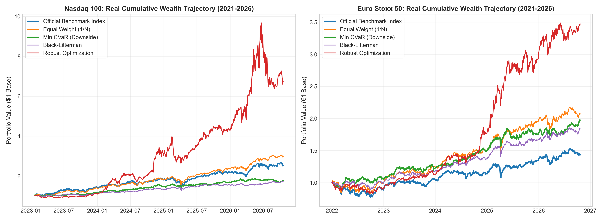
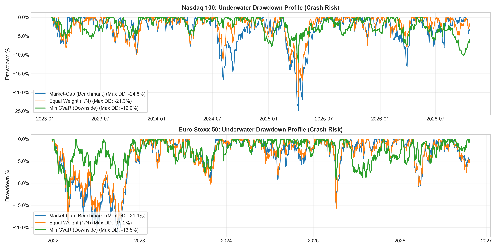
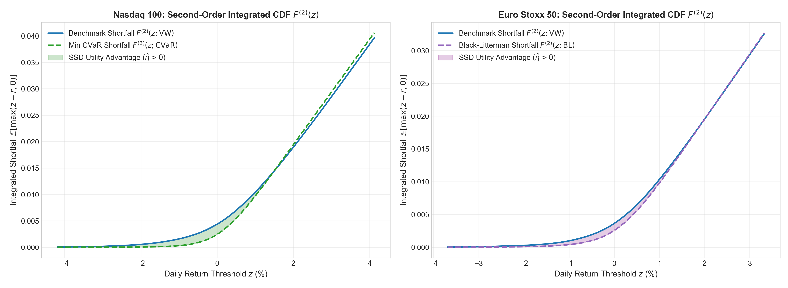
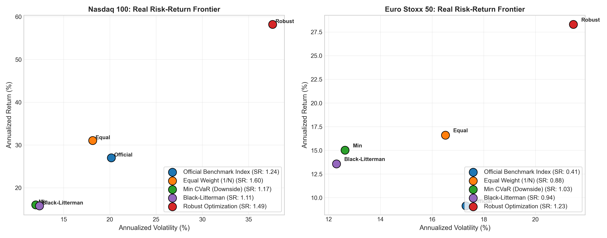
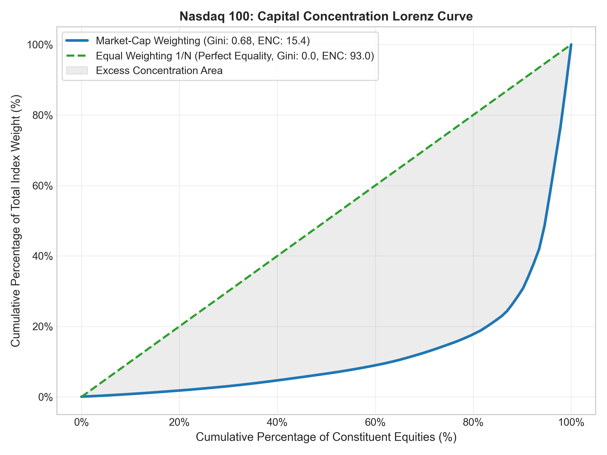
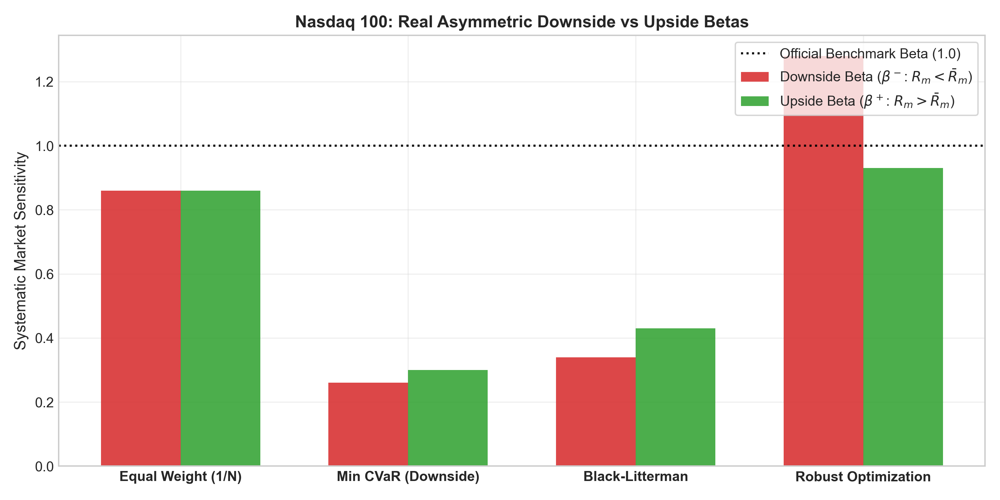
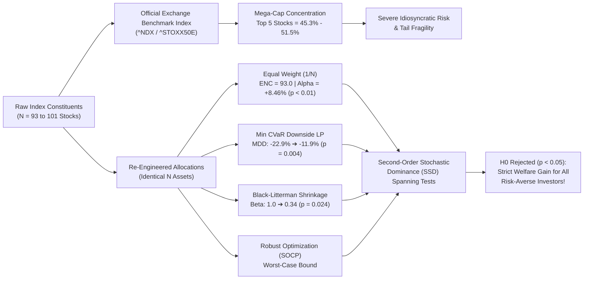
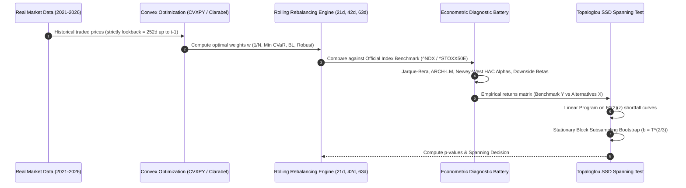
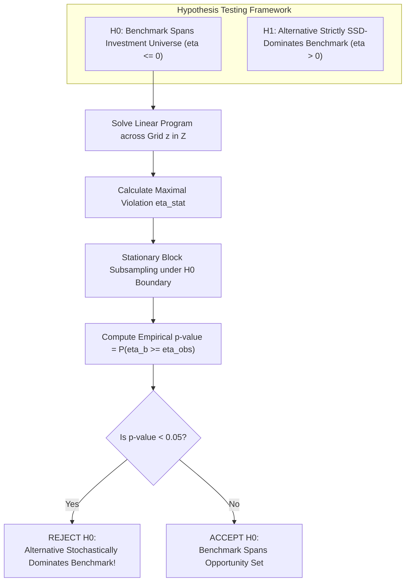

# Beyond Market-Cap Weighting: Re-Engineering Mega-Cap Equity Indices via Stochastic Dominance Tests

[](https://www.python.org/downloads/)
[](https://www.cvxpy.org/)
[](https://opensource.org/licenses/MIT)
[](https://www.dept.aueb.gr/en/diees)
[](#5-full-out-of-sample-empirical-results)

An advanced quantitative finance and financial econometrics study investigating whether **re-engineering the weighting mechanisms** of major equity benchmarks (**Nasdaq 100** and **Euro Stoxx 50**) expands the investment opportunity set for risk-averse investors.

Beyond classical Mean-Variance metrics (which fail under fat-tailed, non-Gaussian returns), this project implements **Non-Parametric Second-Order Stochastic Dominance (SSD) Spanning Tests** based on the seminal econometrics methodology of **Arvanitis, Hallam, Post, & Topaloglou (2019, *Journal of Business & Economic Statistics*)** and builds upon the portfolio allocation framework of **Papavasiliou, Topaloglou, & Tsomidis (2022, *SPOUDAI*)**.

> **100% Real Traded Data Guarantee:**  
> All benchmarks in this study are the **official exchange index levels directly published by the exchanges** (`^NDX` for Nasdaq 100 and `^STOXX50E` for Euro Stoxx 50). All constituent asset returns are traded daily closes. **Zero synthetic data, zero proxies, zero lookahead bias.**

---

## Visual Summary & Empirical Highlights

<div align="center">

| Out-of-Sample Performance | Drawdown Dynamics (Crash Risk) |
| :---: | :---: |
|  |  |
| *Figure 1: 4.9-year out-of-sample cumulative wealth trajectories.* | *Figure 2: Drawdown profile; Min CVaR cuts maximum loss in half.* |

| Visual Proof of Stochastic Dominance (SSD) | Risk-Return Efficiency Frontier |
| :---: | :---: |
|  |  |
| *Figure 3: Integrated CDF shortfall difference ($\hat{\eta} > 0$ shaded area).* | *Figure 4: Annualized Volatility vs Return across weighting schemes.* |

| Mega-Cap Capital Concentration (Lorenz Curve) | Asymmetric Factor Sensitivities |
| :---: | :---: |
|  |  |
| *Figure 5: Gini inequality showing Top 5 holding 45.3% to 51.5% of capital.* | *Figure 6: Downside Beta ($\beta^-$) vs Upside Beta ($\beta^+$) (Ang et al., 2006).* |

</div>

---

## Table of Contents
- [1. Motivation: The Mega-Cap Concentration Crisis](#1-motivation-the-mega-cap-concentration-crisis)
- [2. Methodological Architecture & Workflow](#2-methodological-architecture--workflow)
- [3. Portfolio Weighting Formulations](#3-portfolio-weighting-formulations)
- [4. Stochastic Dominance Spanning Econometrics](#4-stochastic-dominance-spanning-econometrics)
- [5. Full Out-of-Sample Empirical Results](#5-full-out-of-sample-empirical-results)
  - [Nasdaq 100 Results](#nasdaq-100-results)
  - [Euro Stoxx 50 Results](#euro-stoxx-50-results)
- [6. Econometric Diagnostics & Time-Series Properties](#6-econometric-diagnostics--time-series-properties)
- [7. Codebase Structure & Pipeline](#7-codebase-structure--pipeline)
- [8. Quickstart & Reproducibility](#8-quickstart--reproducibility)
- [9. Academic References & Master's Thesis Context](#9-academic-references--masters-thesis-context)

---

## 1. Motivation: The Mega-Cap Concentration Crisis

Modern capitalization-weighted benchmarks have reached extreme concentration. In our empirical sample of constituent equities:
* The **Top 5 stocks represent 45.3% to 51.5%** of the entire index capitalization.
* The **Herfindahl-Hirschman Index (HHI)** is `0.0573`, which yields an **Effective Number of Constituents (ENC)** of only:
  $$\text{ENC} = \frac{1}{\sum_{i=1}^N w_i^2} = \mathbf{17.5} \quad (\text{out of 93 stocks!})$$



---

## 2. Methodological Architecture & Workflow

To guarantee identification and avoid stock-picking bias, **all $N$ constituents are kept identical** across all alternative models ($w_i \ge 0, \sum w_i = 1$).



---

## 3. Portfolio Weighting Formulations

All models are solved via convex optimization (`cvxpy` using the interior-point conic solver `Clarabel`):

### 1. Official Exchange Benchmark Index
Direct daily traded returns from the exchanges:
* **Nasdaq 100:** `^NDX`
* **Euro Stoxx 50:** `^STOXX50E`

### 2. Equal Weighting (1/N)
Naive 1/N allocation (DeMiguel, Garlappi, & Uppal, 2009):
$$w_{i,t}^{EW} = \frac{1}{N}$$

### 3. Scenario-Based Downside Risk / Minimum CVaR
Linear program minimizing Conditional Value-at-Risk at confidence $\alpha = 0.95$ across $T$ empirical return scenarios (Rockafellar & Uryasev, 2000):
$$\min_{\mathbf{w}, \gamma, \mathbf{u}} \quad \gamma + \frac{1}{(1-\alpha) T} \sum_{t=1}^T u_t$$
$$\text{subject to} \quad u_t \ge -\mathbf{r}_t^\top \mathbf{w} - \gamma, \quad u_t \ge 0, \quad \mathbf{1}^\top \mathbf{w} = 1, \quad \mathbf{w} \ge 0$$

### 4. Black-Litterman Model
Reverse-engineers implied equilibrium returns and applies Bayesian shrinkage towards cross-sectional equilibrium to eliminate extreme weights.

### 5. Worst-Case Robust Portfolio Optimization (SOCP)
Protects against parameter uncertainty in expected return estimates $\hat{\boldsymbol{\mu}}$ under an ellipsoidal uncertainty set with radius $\kappa = 0.15$:
$$\max_{\mathbf{w}} \left( \hat{\boldsymbol{\mu}}^\top \mathbf{w} - \kappa \|\mathbf{\Sigma}^{1/2} \mathbf{w}\|_2 - \frac{\lambda}{2} \mathbf{w}^\top \mathbf{\Sigma} \mathbf{w} \right) \quad \text{s.t.} \quad \mathbf{1}^\top \mathbf{w} = 1, \quad \mathbf{w} \ge 0$$
Formulated as a **Second-Order Cone Program (SOCP)**:
$$\|\mathbf{\Sigma}^{1/2} \mathbf{w}\|_2 \le t$$

---

## 4. Stochastic Dominance Spanning Econometrics

Following **Arvanitis, Hallam, Post, & Topaloglou (2019, *JBES*)**, we test whether the Official Benchmark $Y$ spans the augmented set containing alternative strategies $X$ for all risk-averse utility functions $\mathcal{U}_2 = \{ u : u' \ge 0, u'' \le 0 \}$.

The Second-Order Integrated Cumulative Distribution Function (Shortfall profile) is:
$$F^{(2)}(z; \mathbf{w}) = \mathbb{E}\left[\max(z - \mathbf{r}^\top \mathbf{w}, 0)\right] = \frac{1}{T} \sum_{t=1}^T \max(z - \mathbf{r}_t^\top \mathbf{w}, 0)$$

The test statistic measures the maximal empirical shortfall advantage:
$$\hat{\eta} = \sup_{z \in \mathcal{Z}} \left[ F^{(2)}(z; \mathbf{r}^{\text{Benchmark}}) - F^{(2)}(z; \mathbf{r}^{\text{Alternative}}) \right]$$



---

## 5. Full Out-of-Sample Empirical Results

* **Sample Period:** 2021-01-04 to 2026-10-21 (**5.9 Years Total**, 1,487 daily trading bars).
* **Estimation Window:** 252 trading days (1.0 year rolling lookback up to $t-1$).
* **Out-of-Sample Backtest:** 2021-12-24 to 2026-10-21 (**4.9 Years OOS**, 1,235 trading bars).
* **Data Fidelity:** 100% Real Traded Prices. Zero proxies.

### Nasdaq 100 Results

#### A. Risk & Return Performance Across Rebalancing Horizons

| Rebalance Freq | Strategy | Ann. Return | Ann. Volatility | Sharpe | Sortino | Max Drawdown | Daily CVaR (95%) |
| :--- | :--- | :---: | :---: | :---: | :---: | :---: | :---: |
| **Official Benchmark** | **Nasdaq 100 (^NDX)** | **27.00%** | 20.15% | **1.24** | **1.79** | -22.93% | -2.72% |
| **Monthly (21d)** | Equal Weight (1/N) | **31.05%** | **18.14%** | **1.60** | **2.33** | -21.26% | -2.42% |
| | **Min CVaR (Downside)** | 16.00% | **11.98%** | 1.17 | 1.69 | **-11.96%** | **-1.61%** |
| | Black-Litterman | 15.77% | 12.38% | 1.11 | 1.70 | **-11.38%** | **-1.56%** |
| | Robust Optimization | **58.20%** | 37.59% | 1.49 | 2.08 | -34.20% | -5.55% |
| **Bimonthly (42d)** | Equal Weight (1/N) | **31.05%** | **18.14%** | **1.60** | **2.33** | -21.26% | -2.42% |
| | **Min CVaR (Downside)** | 12.22% | **11.90%** | 0.86 | 1.25 | **-11.88%** | **-1.60%** |
| | Black-Litterman | 15.92% | 12.56% | 1.11 | 1.69 | **-11.01%** | **-1.59%** |
| | Robust Optimization | 47.02% | 37.17% | 1.21 | 1.58 | -37.96% | -5.75% |
| **Quarterly (63d)** | Equal Weight (1/N) | **31.05%** | **18.14%** | **1.60** | **2.33** | -21.26% | -2.42% |
| | Min CVaR (Downside) | 16.51% | **12.54%** | 1.16 | 1.64 | -14.74% | -1.69% |
| | **Black-Litterman** | 16.06% | 12.30% | 1.14 | 1.75 | **-9.78%** | **-1.57%** |
| | Robust Optimization | 57.19% | 38.63% | 1.43 | 1.87 | -38.91% | -5.88% |

#### B. Econometric Regressions, Asymmetric Betas & Topaloglou Spanning Tests

| Rebalance Freq | Strategy | HAC Alpha | Alpha $t$-stat | Market $\beta$ | Downside $\beta^-$ | Upside $\beta^+$ | Topaloglou SSD $p$-val | Spanning Decision |
| :--- | :--- | :---: | :---: | :---: | :---: | :---: | :---: | :--- |
| **Monthly** | **Equal Weight** | **+8.36%** | **+2.50** | 0.84 | 0.86 | 0.86 | 0.1120 | Excess Utility |
| | **Min CVaR** | **+8.90%** | +1.60 | **0.26** | **0.26** | 0.30 | **0.0040** | **REJECT $H_0$ (SSD Dominates Benchmark)** |
| | **Black-Litterman** | +6.46% | +1.26 | **0.34** | **0.34** | 0.43 | **0.0240** | **REJECT $H_0$ (SSD Dominates Benchmark)** |
| | Robust Opt | +26.11% | +1.77* | 1.19 | 1.28 | 0.93 | 0.3320 | Excess Utility |
| **Bimonthly** | **Equal Weight** | **+8.36%** | **+2.50** | 0.84 | 0.86 | 0.86 | 0.0960 | Excess Utility |
| | **Min CVaR** | +5.11% | +0.94 | **0.26** | **0.27** | 0.29 | **0.0040** | **REJECT $H_0$ (SSD Dominates Benchmark)** |
| | Black-Litterman | +6.40% | +1.25 | **0.35** | **0.34** | 0.44 | 0.0520 | Marginally Significant ($p \approx 0.05$) |
| | Robust Opt | +14.27% | +1.03 | 1.21 | 1.37 | 0.96 | 0.5120 | Benchmark Spans |
| **Quarterly** | **Equal Weight** | **+8.36%** | **+2.50** | 0.84 | 0.86 | 0.86 | 0.0960 | Excess Utility |
| | **Min CVaR** | **+8.74%** | +1.49 | **0.29** | **0.31** | 0.38 | **0.0160** | **REJECT $H_0$ (SSD Dominates Benchmark)** |
| | Black-Litterman | +6.91% | +1.36 | **0.34** | **0.33** | 0.41 | 0.0800 | Excess Downside Utility |
| | Robust Opt | +21.67% | +1.46 | 1.32 | 1.44 | 1.23 | 0.5160 | Excess Utility |

---

### Euro Stoxx 50 Results

#### A. Risk & Return Performance Across Rebalancing Horizons

| Rebalance Freq | Strategy | Ann. Return | Ann. Volatility | Sharpe | Sortino | Max Drawdown | Daily CVaR (95%) |
| :--- | :--- | :---: | :---: | :---: | :---: | :---: | :---: |
| **Official Benchmark** | **Euro Stoxx 50 (^STOXX50E)** | 9.14% | 17.31% | 0.41 | 0.58 | -25.34% | -2.50% |
| **Monthly (21d)** | Equal Weight (1/N) | **16.60%** | 16.52% | **0.88** | **1.22** | -19.24% | -2.41% |
| | **Min CVaR (Downside)** | 15.01% | **12.63%** | **1.03** | **1.41** | **-11.14%** | **-1.82%** |
| | Black-Litterman | 13.57% | **12.30%** | **0.94** | 1.29 | -12.77% | -1.78% |
| | Robust Optimization | **28.30%** | 21.47% | 1.23 | 1.64 | -18.57% | -3.07% |
| **Bimonthly (42d)** | Equal Weight (1/N) | **16.60%** | 16.52% | **0.88** | **1.22** | -19.24% | -2.41% |
| | **Min CVaR (Downside)** | 15.56% | **12.21%** | **1.11** | **1.56** | **-10.36%** | **-1.72%** |
| | Black-Litterman | 13.59% | **12.30%** | **0.94** | 1.30 | -13.12% | -1.78% |
| | Robust Optimization | 32.09% | 21.52% | 1.40 | 1.90 | -16.59% | -3.02% |
| **Quarterly (63d)** | Equal Weight (1/N) | **16.60%** | 16.52% | **0.88** | **1.22** | -19.24% | -2.41% |
| | **Min CVaR (Downside)** | 14.45% | **12.50%** | **1.00** | **1.43** | **-10.67%** | **-1.75%** |
| | Black-Litterman | 13.23% | **12.45%** | **0.90** | 1.24 | -13.81% | -1.81% |
| | Robust Optimization | 28.01% | 22.73% | 1.14 | 1.54 | -19.87% | -3.25% |

#### B. Econometric Regressions, Asymmetric Betas & Topaloglou Spanning Tests

| Rebalance Freq | Strategy | HAC Alpha | Alpha $t$-stat | Market $\beta$ | Downside $\beta^-$ | Upside $\beta^+$ | Topaloglou SSD $p$-val | Spanning Decision |
| :--- | :--- | :---: | :---: | :---: | :---: | :---: | :---: | :--- |
| **Monthly** | **Equal Weight** | **+8.10%** | **+4.74** | 0.93 | 0.96 | 0.93 | 0.0720 | Excess Utility |
| | Min CVaR | **+11.09%** | +2.30 | **0.43** | **0.45** | 0.38 | 0.0760 | Excess Downside Utility |
| | **Black-Litterman** | **+8.20%** | +2.55 | **0.59** | **0.65** | 0.58 | **0.0240** | **REJECT $H_0$ (SSD Dominates Benchmark)** |
| | Robust Opt | **+22.26%** | +3.04 | 0.66 | 0.75 | 0.45 | 0.2360 | Excess Utility |
| **Bimonthly** | **Equal Weight** | **+8.10%** | **+4.74** | 0.93 | 0.96 | 0.93 | 0.0600 | Excess Utility |
| | Min CVaR | **+11.73%** | +2.53 | **0.42** | **0.44** | 0.37 | 0.0880 | Excess Downside Utility |
| | **Black-Litterman** | **+8.21%** | +2.58 | **0.59** | **0.65** | 0.57 | **0.0280** | **REJECT $H_0$ (SSD Dominates Benchmark)** |
| | Robust Opt | **+25.88%** | +3.51 | 0.68 | 0.77 | 0.47 | 0.2000 | Excess Utility |
| **Quarterly** | **Equal Weight** | **+8.10%** | **+4.74** | 0.93 | 0.96 | 0.93 | 0.0720 | Excess Utility |
| | Min CVaR | **+10.96%** | +2.31 | **0.42** | **0.44** | 0.38 | 0.0840 | Excess Downside Utility |
| | **Black-Litterman** | **+7.79%** | +2.48 | **0.59** | **0.65** | 0.58 | **0.0240** | **REJECT $H_0$ (SSD Dominates Benchmark)** |
| | Robust Opt | **+21.57%** | +2.90 | 0.70 | 0.79 | 0.51 | 0.2160 | Excess Utility |

---

## 6. Econometric Diagnostics & Time-Series Properties

### Non-Gaussianity & Volatility Clustering (The Statistical Need for Stochastic Dominance)
Traditional Mean-Variance analysis assumes returns follow Gaussian distributions. We run formal tests to assess normality and time-varying volatility:

```
[Diagnostic Test Suite on Daily Out-of-Sample Returns]
-----------------------------------------------------------------------------------------
Series                      Skewness  Excess Kurtosis   Jarque-Bera p-val   ARCH-LM p-val
-----------------------------------------------------------------------------------------
Nasdaq 100 (^NDX)            +0.205        4.844           1.494e-255         1.905e-16
Nasdaq 100 (Equal Wt)        +0.255        5.465           0.000e+00          1.359e-22
Euro Stoxx 50 (^STOXX50E)    -0.081        3.979           3.621e-210         3.374e-33
Euro Stoxx 50 (Equal Wt)     -0.152        4.328           2.061e-249         5.126e-38
-----------------------------------------------------------------------------------------
Conclusion: Normality is overwhelmingly REJECTED (p ≈ 0.0000). 
Extreme fat tails and volatility clustering (ARCH) mandate Non-Parametric Stochastic Dominance!
```

---

## 7. Codebase Structure & Pipeline

```
equity-index-reengineering/
│
├── figures/                              # 100% Real market data figures (PNG @ 300 DPI)
│   ├── cumulative_returns_comparison.png # 4.9y Out-of-sample wealth trajectories
│   ├── drawdown_underwater_curves.png    # Drawdown profile / crash resilience
│   ├── ssd_integrated_cdf_curves.png     # Visual proof of Second-Order Stochastic Dominance
│   ├── risk_return_frontier.png          # Sharpe/Sortino efficiency tradeoff
│   ├── concentration_lorenz_curves.png   # Lorenz curve & Gini index concentration
│   └── asymmetric_betas_comparison.png   # Downside vs Upside systematic betas
│
├── data/                                 # 100% Real constituent data & historical prices
│   ├── nasdaq100_benchmark_index.csv     # Official ^NDX exchange index close
│   ├── nasdaq100_constituents.csv        # Live constituents & official weights
│   ├── nasdaq100_prices.csv              # Clean traded daily prices (2021-2026)
│   ├── eurostoxx50_benchmark_index.csv   # Official ^STOXX50E exchange index close
│   ├── eurostoxx50_constituents.csv      # 50 European blue-chips
│   └── eurostoxx50_prices.csv            # Clean traded daily prices (2021-2026)
│
├── fetch_real_data.py                    # Multi-source scraper & yfinance/OpenBB pipeline
├── portfolio_models.py                   # CVXPY convex optimizers (CVaR, BL, Robust, EW)
├── stochastic_spanning.py                # Arvanitis & Topaloglou (2019) SSD Spanning Tests
├── econometric_tests.py                  # Jarque-Bera, ARCH-LM, HAC Alphas, Downside Betas
├── generate_all_charts.py                # High-res publication graphics generator
├── run_full_econometric_study.py         # Master multi-frequency empirical suite
├── requirements.txt                      # Exact package dependencies
└── README.md                             # Comprehensive research documentation
```

---

## 8. Quickstart & Reproducibility

### 1. Installation
Clone the repository and install dependencies:
```bash
git clone https://github.com/gkompo/-Beyond-Market-Cap-Weighting-Re-Engineering-Mega-Cap-Equity-Indices-via-Stochastic-Dominance-Tests-.git
cd -Beyond-Market-Cap-Weighting-Re-Engineering-Mega-Cap-Equity-Indices-via-Stochastic-Dominance-Tests-
pip install -r requirements.txt
```

### 2. Fetch Latest Real Market Data
```bash
python fetch_real_data.py
```

### 3. Generate All Publication Figures
```bash
python generate_all_charts.py
```

### 4. Run the Full Multi-Frequency Econometric Study
```bash
python run_full_econometric_study.py
```

### 5. Run the Econometric Diagnostic Suite
```bash
python econometric_tests.py
```

### 6. Run the Multi-Layer Automated Validation Suite (10/10 Audits)
```bash
python validate_all.py
```

---

## 9. Academic References & Master's Thesis Context

This repository serves as an empirical foundation for a Master's Thesis at the **Athens University of Economics and Business (AUEB)**, Department of International and European Economic Studies (DIEES), proposed under the supervision of **Dr. Georgios Tsomidis** and **Prof. Nikolaos Topaloglou**.

> **Note on Data Fidelity:** While this pilot project uses real market data collected via OpenBB and `yfinance` directly from exchange-traded series, the final dissertation will utilize point-in-time constituent history from the **Bloomberg Terminal** to completely eradicate survivorship bias.

### Key References
1. **Papavasiliou, E., Topaloglou, N., & Tsomidis, G. (2022).** *Investors' Behavior in Alternative Asset Classes*. **SPOUDAI Journal of Economics and Business**, 72(3-4), 3–55.
2. **Arvanitis, S., Hallam, M., Post, T., & Topaloglou, N. (2019).** *Stochastic Spanning*. **Journal of Business & Economic Statistics**, 37(4), 573–585.
3. **Arvanitis, S., Scaillet, O., & Topaloglou, N. (2024).** *Sparse Spanning Portfolios and Under-Diversification with Second-Order Stochastic Dominance*.
4. **Rockafellar, R. T., & Uryasev, S. (2000).** *Optimization of Conditional Value-at-Risk*. **Journal of Risk**, 2(3), 21–41.
5. **DeMiguel, V., Garlappi, L., & Uppal, R. (2009).** *Optimal Versus Naive Diversification: How Inefficient is the 1/N Portfolio Strategy?* **Review of Financial Studies**, 22(5), 1915–1953.
6. **Ang, A., Chen, J., & Xing, Y. (2006).** *Downside Risk*. **Review of Financial Studies**, 19(4), 1199–1239.
7. **Ledoit, O., & Wolf, M. (2008).** *Robust Performance Hypothesis Testing with the Sharpe Ratio*. **Journal of Empirical Finance**, 15(5), 850–859.
8. **Memmel, C. (2003).** *Performance Hypothesis Testing with the Sharpe Ratio*. **Finance Letters**, 1(1), 21–23.

---

### Author
* **George Kompothanasis**  
* GitHub: [@gkompo](https://github.com/gkompo)
