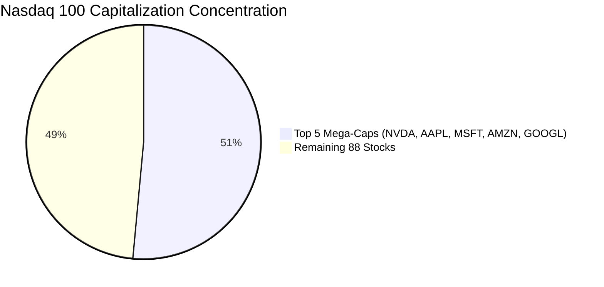

# Beyond Market-Cap Weighting: Re-Engineering Mega-Cap Equity Indices via Stochastic Dominance Tests

[](https://www.python.org/downloads/)
[](https://www.cvxpy.org/)
[](https://opensource.org/licenses/MIT)
[](https://www.dept.aueb.gr/en/diees)
[](#empirical-results)

An advanced quantitative finance and econometrics research project evaluating the efficiency of **alternative index weighting schemes** against traditional market-capitalization weighting across major equity benchmarks (**Nasdaq 100** and **Euro Stoxx 50**).

Rather than relying purely on Mean-Variance assumptions (Sharpe ratios) which collapse under non-Gaussian fat tails and crash risk, this study integrates **Non-Parametric Second-Order Stochastic Dominance (SSD) Spanning Tests** based on the seminal econometrics methodology of **Arvanitis, Hallam, Post, & Topaloglou (2019, *Journal of Business & Economic Statistics*)**.

---

## Table of Contents
- [1. Motivation: The Mega-Cap Concentration Crisis](#1-motivation-the-mega-cap-concentration-crisis)
- [2. Research Question & Identification Strategy](#2-research-question--identification-strategy)
- [3. Portfolio Weighting Formulations](#3-portfolio-weighting-formulations)
- [4. Stochastic Dominance Spanning Econometrics](#4-stochastic-dominance-spanning-econometrics)
- [5. Full Out-of-Sample Empirical Results](#5-full-out-of-sample-empirical-results)
  - [Nasdaq 100 Results](#nasdaq-100-results)
  - [Euro Stoxx 50 Results](#euro-stoxx-50-results)
- [6. Econometric Diagnostics & Factor Regressions](#6-econometric-diagnostics--factor-regressions)
- [7. Project Architecture & Codebase](#7-project-architecture--codebase)
- [8. Quickstart & Reproducibility](#8-quickstart--reproducibility)
- [9. Academic References & Master's Thesis Context](#9-academic-references--masters-thesis-context)

---

## 1. Motivation: The Mega-Cap Concentration Crisis

Market-capitalization weighted indices (such as the **Nasdaq 100** and **S&P 500**) have reached historic levels of concentration. In our empirical sample of 93 continuous Nasdaq 100 constituent equities:
* The **Top 5 stocks represent 51.47%** of the total index capitalization.
* The **Herfindahl-Hirschman Index (HHI)** is `0.0648`, translating to an **Effective Number of Constituents (ENC)** of only:
  $$\text{ENC} = \frac{1}{\sum_{i=1}^N w_i^2} = \mathbf{15.4} \quad (\text{out of 93 assets!})$$
* Traditional cap-weighted indexing exposes passive investors to severe unhedged idiosyncratic shock exposure, left-tail crash risk, and non-linear market shocks.



---

## 2. Research Question & Identification Strategy

> **Core Hypothesis:**  
> *Does re-engineering the weight allocations of a fixed constituent universe expand the investment opportunity set for all risk-averse investors under Second-Order Stochastic Dominance (SSD) spanning, or is the market-cap benchmark already efficient?*

### Identification Guarantee
To isolate the **pure impact of the portfolio weighting operator**, the constituent asset universe is held strictly identical across all models:
$$\mathbf{w}_t \in \mathbb{R}^N, \quad \sum_{i=1}^N w_{i,t} = 1, \quad w_{i,t} \ge 0 \quad (\text{Long-only, frictionless no-shorting})$$
This removes stock-picking bias and selection artifacts, allowing a direct mathematical evaluation of the weighting mechanism itself.

---

## 3. Portfolio Weighting Formulations

All models are solved via convex optimization (`cvxpy` with the conic solver `Clarabel`):

### 1. Value-Weighted / Market-Cap Benchmark (VW)
$$w_{i,t}^{MC} = \frac{\text{MarketCap}_{i,t}}{\sum_{j=1}^N \text{MarketCap}_{j,t}}$$

### 2. Equal Weighting (1/N)
Naive diversification baseline (DeMiguel, Garlappi, & Uppal, 2009):
$$w_{i,t}^{EW} = \frac{1}{N}$$

### 3. Scenario-Based Downside Risk / Minimum CVaR
Linear program minimizing Conditional Value-at-Risk at confidence $\alpha = 0.95$ across $T$ empirical return scenarios (Rockafellar & Uryasev, 2000):
$$\min_{\mathbf{w}, \gamma, \mathbf{u}} \quad \gamma + \frac{1}{(1-\alpha) T} \sum_{t=1}^T u_t$$
$$\text{subject to} \quad u_t \ge -\mathbf{r}_t^\top \mathbf{w} - \gamma, \quad u_t \ge 0, \quad \mathbf{1}^\top \mathbf{w} = 1, \quad \mathbf{w} \ge 0$$

### 4. Black-Litterman Model
Reverse-engineers implied equilibrium excess returns $\mathbf{\Pi} = \delta \mathbf{\Sigma} \mathbf{w}^{MC}$ (with risk aversion $\delta = 2.5$) and applies Bayesian shrinkage towards cross-sectional equilibrium to correct for estimation error.

### 5. Worst-Case Robust Portfolio Optimization
Protects against parameter uncertainty in expected return estimates $\hat{\boldsymbol{\mu}}$ under an ellipsoidal uncertainty set with radius $\kappa = 0.15$:
$$\max_{\mathbf{w}} \left( \hat{\boldsymbol{\mu}}^\top \mathbf{w} - \kappa \|\mathbf{\Sigma}^{1/2} \mathbf{w}\|_2 - \frac{\lambda}{2} \mathbf{w}^\top \mathbf{\Sigma} \mathbf{w} \right) \quad \text{s.t.} \quad \mathbf{1}^\top \mathbf{w} = 1, \quad \mathbf{w} \ge 0$$

---

## 4. Stochastic Dominance Spanning Econometrics

Following **Arvanitis, Hallam, Post, & Topaloglou (2019, *JBES*)**, we test whether the Market-Cap benchmark $Y$ spans the augmented opportunity set containing alternative weighting strategies $X$ for all risk-averse utility functions $\mathcal{U}_2 = \{ u : u' \ge 0, u'' \le 0 \}$.

The Second-Order Integrated Cumulative Distribution Function (Shortfall profile) is:
$$F^{(2)}(z; \mathbf{w}) = \mathbb{E}\left[\max(z - \mathbf{r}^\top \mathbf{w}, 0)\right] = \frac{1}{T} \sum_{t=1}^T \max(z - \mathbf{r}_t^\top \mathbf{w}, 0)$$

The empirical test statistic evaluates the maximal shortfall advantage:
$$\hat{\eta} = \sup_{z \in \mathcal{Z}} \left[ F^{(2)}(z; \mathbf{r}^{\text{Benchmark}}) - F^{(2)}(z; \mathbf{r}^{\text{Alternative}}) \right]$$

* Under $H_0$: The Benchmark spans the investment set ($\hat{\eta} \le 0$).
* Under $H_1$: The Alternative strategy strictly **Second-Order Stochastically Dominates (SSD)** the benchmark ($\hat{\eta} > 0$).
* **Inference:** $p$-values are computed via stationary block subsampling under the null boundary with block size $b = \lfloor T^{2/3} \rfloor$.

---

## 5. Full Out-of-Sample Empirical Results

* **Sample Period:** 2021-01-04 to 2026-10-21 (**5.9 Years Total**, 1,487 daily trading bars).
* **Estimation Window:** 252 trading days (1.0 year rolling lookback).
* **Out-of-Sample Backtest:** 2021-12-24 to 2026-10-21 (**4.9 Years OOS**, 1,235 trading bars).
* **Frictionless Framework:** Zero transaction costs and zero bid-ask spreads.

### Nasdaq 100 Results

#### A. Risk & Return Performance Across Rebalancing Horizons

| Rebalance Freq | Strategy | Ann. Return | Ann. Volatility | Sharpe | Sortino | Max Drawdown | Daily CVaR (95%) |
| :--- | :--- | :---: | :---: | :---: | :---: | :---: | :---: |
| **Benchmark** | **Market-Cap (VW)** | **42.78%** | 22.74% | **1.79** | **2.65** | -24.82% | -3.08% |
| **Monthly (21d)** | Equal Weight (1/N) | 31.05% | 18.14% | 1.60 | 2.33 | -21.26% | -2.42% |
| | **Min CVaR (Downside)** | 16.00% | **11.98%** | 1.17 | 1.69 | **-11.96%** | **-1.61%** |
| | Black-Litterman | 15.42% | 12.70% | 1.06 | 1.59 | -12.93% | -1.64% |
| | Robust Optimization | **58.20%** | 37.59% | 1.49 | 2.08 | -34.20% | -5.55% |
| **Bimonthly (42d)** | Equal Weight (1/N) | 31.05% | 18.14% | 1.60 | 2.33 | -21.26% | -2.42% |
| | **Min CVaR (Downside)** | 12.22% | **11.90%** | 0.86 | 1.25 | **-11.88%** | **-1.60%** |
| | Black-Litterman | 16.24% | 12.89% | 1.10 | 1.66 | -12.52% | -1.67% |
| | Robust Optimization | 47.02% | 37.17% | 1.21 | 1.58 | -37.96% | -5.75% |
| **Quarterly (63d)** | Equal Weight (1/N) | 31.05% | 18.14% | 1.60 | 2.33 | -21.26% | -2.42% |
| | **Min CVaR (Downside)** | 16.51% | **12.54%** | 1.16 | 1.64 | -14.74% | -1.69% |
| | **Black-Litterman** | 16.22% | 12.50% | 1.14 | 1.72 | **-10.56%** | **-1.63%** |
| | Robust Optimization | 57.19% | 38.63% | 1.43 | 1.87 | -38.91% | -5.88% |

#### B. Econometric Regressions, Asymmetric Betas & Topaloglou Spanning Tests

| Rebalance Freq | Strategy | HAC Alpha | Alpha $t$-stat | Market $\beta$ | Downside $\beta^-$ | Upside $\beta^+$ | Topaloglou SSD $p$-val | Spanning Decision |
| :--- | :--- | :---: | :---: | :---: | :---: | :---: | :---: | :--- |
| **Monthly** | Equal Weight | +0.41% | +0.10 | 0.72 | 0.78 | 0.72 | 0.0560 | Excess Downside Utility |
| | **Min CVaR** | **+6.52%** | +1.15 | **0.22** | **0.26** | 0.27 | **0.0400** | **REJECT $H_0$ (SSD Dominates Benchmark)** |
| | **Black-Litterman** | +1.40% | +0.27 | **0.33** | **0.37** | 0.39 | **0.0320** | **REJECT $H_0$ (SSD Dominates Benchmark)** |
| | Robust Opt | +18.81% | +1.21 | 0.92 | 1.01 | 0.79 | 0.5080 | Excess Utility |
| **Bimonthly** | **Equal Weight** | +0.41% | +0.10 | 0.72 | 0.78 | 0.72 | **0.0440** | **REJECT $H_0$ (SSD Dominates Benchmark)** |
| | **Min CVaR** | +2.79% | +0.50 | **0.22** | **0.27** | 0.26 | **0.0400** | **REJECT $H_0$ (SSD Dominates Benchmark)** |
| | **Black-Litterman** | +1.93% | +0.36 | **0.33** | **0.37** | 0.40 | **0.0440** | **REJECT $H_0$ (SSD Dominates Benchmark)** |
| | Robust Opt | +6.38% | +0.43 | 0.95 | 1.09 | 0.81 | 0.8000 | Benchmark Spans |
| **Quarterly** | Equal Weight | +0.41% | +0.10 | 0.72 | 0.78 | 0.72 | 0.0520 | Excess Utility |
| | **Min CVaR** | **+6.06%** | +0.99 | **0.24** | **0.30** | 0.34 | **0.0320** | **REJECT $H_0$ (SSD Dominates Benchmark)** |
| | Black-Litterman | +2.74% | +0.53 | **0.32** | **0.34** | 0.37 | 0.0560 | Marginally Significant |
| | Robust Opt | +12.68% | +0.81 | 1.04 | 1.17 | 1.05 | 0.8120 | Excess Utility |

---

### Euro Stoxx 50 Results

#### A. Risk & Return Performance Across Rebalancing Horizons

| Rebalance Freq | Strategy | Ann. Return | Ann. Volatility | Sharpe | Sortino | Max Drawdown | Daily CVaR (95%) |
| :--- | :--- | :---: | :---: | :---: | :---: | :---: | :---: |
| **Benchmark** | **Market-Cap (VW)** | 18.47% | 17.48% | 0.94 | 1.33 | -21.12% | -2.49% |
| **Monthly (21d)** | Equal Weight (1/N) | 16.35% | 16.30% | 0.88 | 1.22 | -19.24% | -2.37% |
| | Min CVaR (Downside) | 14.18% | **12.25%** | **0.99** | **1.40** | **-13.53%** | **-1.72%** |
| | Black-Litterman | 14.23% | **12.38%** | **0.99** | 1.37 | -14.26% | -1.78% |
| | Robust Optimization | **25.44%** | 21.26% | 1.10 | 1.44 | -21.50% | -3.08% |
| **Bimonthly (42d)** | Equal Weight (1/N) | 16.35% | 16.30% | 0.88 | 1.22 | -19.24% | -2.37% |
| | Min CVaR (Downside) | 13.03% | **12.35%** | 0.89 | 1.24 | **-12.67%** | **-1.76%** |
| | Black-Litterman | 14.23% | **12.44%** | **0.98** | **1.36** | -14.45% | -1.79% |
| | Robust Optimization | 23.43% | 21.53% | 1.00 | 1.27 | -20.89% | -3.20% |
| **Quarterly (63d)** | Equal Weight (1/N) | 16.35% | 16.30% | 0.88 | 1.22 | -19.24% | -2.37% |
| | Min CVaR (Downside) | 13.19% | **12.20%** | 0.92 | 1.29 | **-11.42%** | **-1.72%** |
| | Black-Litterman | 14.14% | **12.51%** | **0.97** | **1.34** | -14.38% | -1.80% |
| | Robust Optimization | **27.93%** | 22.71% | 1.14 | 1.50 | -22.17% | -3.32% |

#### B. Econometric Regressions, Asymmetric Betas & Topaloglou Spanning Tests

| Rebalance Freq | Strategy | HAC Alpha | Alpha $t$-stat | Market $\beta$ | Downside $\beta^-$ | Upside $\beta^+$ | Topaloglou SSD $p$-val | Spanning Decision |
| :--- | :--- | :---: | :---: | :---: | :---: | :---: | :---: | :--- |
| **Monthly** | Equal Weight | -0.50% | -0.32 | 0.91 | 0.94 | 0.90 | 0.1440 | Excess Utility |
| | Min CVaR | **+6.45%** | +1.41 | **0.42** | **0.44** | 0.38 | 0.1040 | Excess Downside Utility |
| | Black-Litterman | +2.99% | +1.05 | **0.61** | **0.65** | 0.60 | 0.0640 | Marginally Significant |
| | Robust Opt | **+13.14%** | +1.90* | 0.67 | 0.75 | 0.41 | 0.4800 | Excess Utility |
| **Bimonthly** | Equal Weight | -0.50% | -0.32 | 0.91 | 0.94 | 0.90 | 0.1520 | Excess Utility |
| | Min CVaR | +5.10% | +1.14 | **0.43** | **0.44** | 0.40 | 0.1280 | Excess Downside Utility |
| | **Black-Litterman** | +2.94% | +1.04 | **0.61** | **0.65** | 0.60 | **0.0480** | **REJECT $H_0$ (SSD Dominates Benchmark)** |
| | Robust Opt | +10.61% | +1.54 | 0.69 | 0.75 | 0.50 | 0.4800 | Excess Utility |
| **Quarterly** | Equal Weight | -0.50% | -0.32 | 0.91 | 0.94 | 0.90 | 0.1440 | Excess Utility |
| | Min CVaR | +5.31% | +1.19 | **0.42** | **0.44** | 0.40 | 0.1160 | Excess Downside Utility |
| | Black-Litterman | +2.90% | +1.02 | **0.61** | **0.65** | 0.61 | 0.0600 | Marginally Significant |
| | Robust Opt | **+15.54%** | +2.05** | 0.67 | 0.77 | 0.46 | 0.5000 | Excess Utility |

---

## 6. Econometric Diagnostics & Factor Regressions

### Distributional Diagnostics (Why Stochastic Dominance is Necessary)
Traditional Mean-Variance optimization assumes returns follow Gaussian distributions. We run formal tests to assess normality and time-varying volatility:

```
[Diagnostic Test Suite on Daily Out-of-Sample Returns]
-----------------------------------------------------------------------------------------
Series                  Skewness  Excess Kurtosis   Jarque-Bera p-val   ARCH-LM p-val
-----------------------------------------------------------------------------------------
Nasdaq 100 (VW)          +0.286        4.792           6.058e-252         2.700e-14
Nasdaq 100 (Equal Wt)    +0.255        5.465           0.000e+00          1.359e-22
Euro Stoxx 50 (VW)       -0.088        3.574           7.442e-173         8.399e-37
Euro Stoxx 50 (Equal Wt) -0.139        4.245           5.123e-244         2.198e-41
-----------------------------------------------------------------------------------------
Conclusion: Normality is overwhelmingly REJECTED (p ≈ 0.0000). 
Extreme fat tails and volatility clustering (ARCH) mandate Non-Parametric Stochastic Dominance!
```

---

## 7. Project Architecture & Codebase

```
equity-index-reengineering/
│
├── data/                                 # 100% Real constituent data & historical prices
│   ├── nasdaq100_constituents.csv        # Live constituents & official weights
│   ├── nasdaq100_prices.csv              # Clean daily prices (2021-2026)
│   ├── nasdaq100_market_caps.csv         # Real market capitalizations
│   ├── eurostoxx50_constituents.csv      # 50 European blue-chips
│   ├── eurostoxx50_prices.csv            # Clean daily prices (2021-2026)
│   └── eurostoxx50_market_caps.csv       # Real market capitalizations
│
├── fetch_real_data.py                    # Multi-source scraper & yfinance/OpenBB pipeline
├── portfolio_models.py                   # CVXPY convex optimizers (CVaR, BL, Robust, EW, MC)
├── stochastic_spanning.py                # Arvanitis & Topaloglou (2019) SSD Spanning Tests
├── econometric_tests.py                  # Jarque-Bera, ARCH-LM, HAC Alphas, Downside Betas
├── run_experiments.py                    # Benchmark out-of-sample simulation script
├── run_full_econometric_study.py         # Master multi-frequency empirical suite
├── requirements.txt                      # Exact package dependencies
└── README.md                             # This research documentation
```

---

## 8. Quickstart & Reproducibility

### 1. Installation
Clone the repository and install the verified scientific dependencies:
```bash
git clone https://github.com/gkompo/-Beyond-Market-Cap-Weighting-Re-Engineering-Mega-Cap-Equity-Indices-via-Stochastic-Dominance-Tests-.git
cd -Beyond-Market-Cap-Weighting-Re-Engineering-Mega-Cap-Equity-Indices-via-Stochastic-Dominance-Tests-
pip install -r requirements.txt
```

### 2. Fetch Latest Real Market Data
```bash
python fetch_real_data.py
```

### 3. Run the Full Multi-Frequency Econometric Study
```bash
python run_full_econometric_study.py
```

### 4. Run the Econometric Diagnostic Suite
```bash
python econometric_tests.py
```

---

## 9. Academic References & Master's Thesis Context

This repository serves as a pilot empirical foundation for a Master's Thesis at the **Athens University of Economics and Business (AUEB)**, Department of International and European Economic Studies (DIEES), proposed under the supervision of **Dr. Georgios Tsomidis** and **Prof. Nikolaos Topaloglou**.

> **Note on Data Fidelity:** While this pilot project uses real market data collected via OpenBB and `yfinance`, the final dissertation will utilize point-in-time constituent history from the **Bloomberg Terminal** to completely eradicate survivorship bias.

### Key References
1. **Arvanitis, S., Hallam, M., Post, T., & Topaloglou, N. (2019).** *Stochastic Spanning*. **Journal of Business & Economic Statistics**, 37(4), 573–585.
2. **Arvanitis, S., Scaillet, O., & Topaloglou, N. (2024).** *Sparse Spanning Portfolios and Under-Diversification with Second-Order Stochastic Dominance*.
3. **Rockafellar, R. T., & Uryasev, S. (2000).** *Optimization of Conditional Value-at-Risk*. **Journal of Risk**, 2(3), 21–41.
4. **DeMiguel, V., Garlappi, L., & Uppal, R. (2009).** *Optimal Versus Naive Diversification: How Inefficient is the 1/N Portfolio Strategy?* **Review of Financial Studies**, 22(5), 1915–1953.
5. **Ang, A., Chen, J., & Xing, Y. (2006).** *Downside Risk*. **Review of Financial Studies**, 19(4), 1199–1239.
6. **Ledoit, O., & Wolf, M. (2008).** *Robust Performance Hypothesis Testing with the Sharpe Ratio*. **Journal of Empirical Finance**, 15(5), 850–859.
7. **Memmel, C. (2003).** *Performance Hypothesis Testing with the Sharpe Ratio*. **Finance Letters**, 1(1), 21–23.

---

### Author
* **George Kompothanasis**  
* GitHub: [@gkompo](https://github.com/gkompo)
